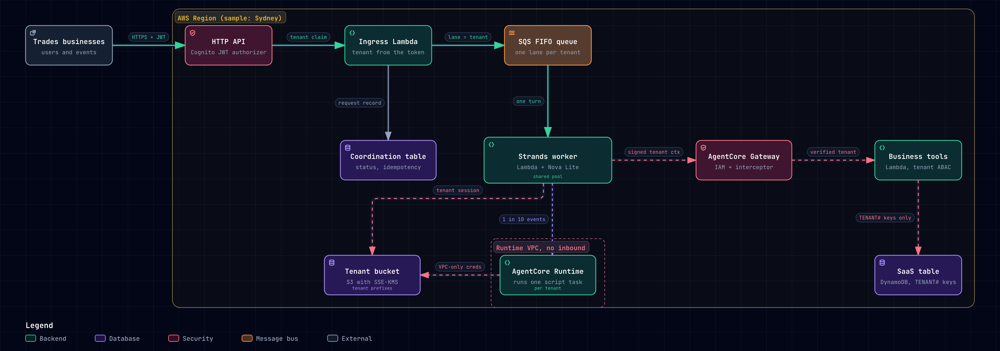

# Split agent harness with tenant isolation

> This is a sample for learning and evaluation, not a production service. It deploys real,
> billable AWS resources and shows one way to isolate tenants; review and adapt it before any
> production use. Scale and quota figures are stated per AWS account and Region.

A deployable sample of the decoupled ("split") agent harness: the agent loop runs on a shared
pool of Lambda workers across tenants, normal business actions go straight to AgentCore Gateway,
and only code or file work starts an isolated AgentCore Runtime session. On top of that design it
implements a tenant isolation boundary built from AWS primitives (STS session tags, IAM ABAC,
KMS, endpoint and resource policies).

[docs/tenant-isolation.md](docs/tenant-isolation.md) answers the eight isolation requirements one
by one, with the threat model, quotas at 10,000 and 100,000 tenants, and the cost of the boundary.



Two more diagrams, one turn's isolation checks in order and the billed compute per event, are in
[docs/diagrams/](docs/diagrams/); the editable sources are under `docs/diagrams/src/`.

## How the code maps to the architecture

| Component | Code | Notes |
| --- | --- | --- |
| Authenticated ingress | `src/ingress/handler.py` | Cognito JWT for users, SigV4 for system events; tenant from the token, not the body |
| SQS FIFO, one lane per tenant | `infra/stack.py` (`TurnQueue`) | Message group = tenant hash; tenant-qualified dedup IDs; only ingress may send |
| Shared Strands harness worker | `src/worker/handler.py`, `src/worker/agent.py` | One message = one turn; snapshot session state per tenant in S3 |
| Request status, idempotency, lease | `src/worker/coordination.py` | Per-tenant lease in DynamoDB; its fence counter is recorded but not yet checked |
| Direct tool path | `src/worker/gateway_client.py`, `src/tools/handler.py` | SigV4 MCP calls to an IAM-authenticated Gateway; model-safe tool aliases |
| Tenant context on tool calls | `src/shared/tenant_token.py`, `src/interceptor/handler.py` | KMS HMAC token verified by a Gateway REQUEST interceptor |
| Lazy execution path | `src/worker/execute_process.py`, `src/runtime/` | One complete script per call; inline or object-scoped S3 transport |
| Tenant-scoped credentials | `src/shared/tenant_session.py` | `TenantId` session tag on every tenant data access |
| Isolation policies | `infra/policies.py` | Pure functions, deployed by CDK and checked by the IAM policy simulator |
| Live demo | `demo/` | Local page and command-line demo that drive the deployed stack as two tenants and run the isolation checks |
| Cost model | `demo/cost_model.py` | All-on-AgentCore against the split; reproduces $4.11 vs $1.67 per tenant-month and adds two corrections |
| Measured usage | `demo/measured.py` | Read-only CloudWatch and turn records from the live stack, priced at Sydney list rates |
| Diagrams | `docs/diagrams/` | Architecture, one-turn sequence and billed-time PNGs (editable sources in `docs/diagrams/src/`) |

## Repository layout

```
app.py, cdk.json          CDK app (Python)
infra/                    stack and IAM policy documents
src/                      Lambda and runtime code
samples/prices.csv        sample upload used by the walkthrough and the demo
scripts/build_assets.sh   builds the arm64 Lambda layer and the runtime package
scripts/simulate_isolation.py   read-only IAM policy simulation of the boundary
tests/                    unit, integration (moto) and template tests
demo/                     local demo page (127.0.0.1 only), demo script, live isolation checks, cost model
docs/                     design notes, diagrams and evidence
```

## Prerequisites

Python 3.13 or later and Node.js 22 or 24 (for the CDK CLI through `npx`); jsii does not support
Node 20, which is end of life. Tested in `ap-southeast-2` (Sydney); set the Region explicitly on
every command below, since it is not taken from the profile.

## Build and test

```bash
python3 -m venv .venv
.venv/bin/pip install -r requirements/dev.txt
.venv/bin/python -m pytest -q          # full suite, no AWS calls
./scripts/build_assets.sh              # .build/layers/agent and .build/runtime (no Docker)
```

The worker layer and runtime package are built for `arm64` Linux (Python 3.13). `requirements/`
pins the direct dependencies, including `certifi` to the release without the CA roots in AWS
security bulletin 2026-150-AWS; for production, resolve hashed lockfiles against the `cp313`
`manylinux2014_aarch64` target and install them with `pip --require-hashes`.

The IAM simulation needs credentials for any account but creates nothing:

```bash
AWS_PROFILE=<profile> .venv/bin/python scripts/simulate_isolation.py --out .build/evidence/iam-simulation.md
```

## Cost

The deployed stack has a few always-on charges that do not scale with tenants, plus per-use
charges. At `ap-southeast-2` list prices (October 2026): the CloudWatch Logs interface endpoint in
two Availability Zones is about **$19 a month**, and the two customer-managed KMS keys are about
**$2 a month**; there is no NAT gateway. Everything else (Lambda, SQS, DynamoDB on demand, S3,
AgentCore Runtime, Bedrock tokens) is per use. The per-tenant model and the measured cost are in
the demo's Cost tab and in [docs/evidence/live-cost.md](docs/evidence/live-cost.md).

Set an [AWS Budgets](https://docs.aws.amazon.com/cost-management/latest/userguide/budgets-managing-costs.html)
alert before you deploy, and destroy the stack when you are done (see [Clean-up](#clean-up)).

## Deploy

The CDK CLI is pinned in `package.json` (older global installs cannot read this cloud assembly
version). Install it once with `npm ci`, then call it through `npx cdk`:

```bash
npm ci                                                         # installs the pinned aws-cdk CLI
npx cdk bootstrap --profile <profile> -c region=ap-southeast-2    # once per account and Region
npx cdk deploy --profile <profile> -c region=ap-southeast-2
```

No role is given break-glass by default. `-c adminRoleArns=...` is optional and only for a role you
want to let past the tenant policies.

Context options:

| Key | Default | Purpose |
| --- | --- | --- |
| `region` | `ap-southeast-2` | Deployment Region (not taken from the profile) |
| `modelId` | `amazon.nova-lite-v1:0` | In-Region Bedrock model (IAM is pinned to it). A cross-Region profile such as `apac.amazon.nova-lite-v1:0` doubles the per-minute quota but leaves the Region |
| `adminRoleArns` | none | Break-glass roles allowed past the bucket, runtime and Gateway policies |
| `eventProducerRoleArns` | none | Full role ARNs (account included) allowed to post system events to `POST /events` |
| `eventTurnTools` | `scoped` | `all` lets event turns create quotes and run scripts; `scoped` denies both on the event turn itself (the stored text still reaches the tenant's next user turn) |
| `dnsFirewallMode` | `BLOCK` | `ALERT` resolves every name and only logs, to find a missing name (synth warning) |
| `modelRequestsPerMinute` | `200` | Model request quota the worker cap is derived from (in-Region Nova Lite; `400` cross-Region) |
| `modelCallsPerTurn` | `3` | Model calls a turn, used with the quota to size worker concurrency |
| `workerMaxConcurrency` | derived | Reserved worker concurrency; defaults to `modelRequestsPerMinute / modelCallsPerTurn` |
| `maxOpenRequests` | `20` | Requests one tenant may have queued or running; more get HTTP 429 |
| `apiRateLimit` / `apiBurstLimit` | `50` / `100` | API stage throttling, requests per second and burst |
| `s3PrefixListId` | looked up | S3 managed prefix list for runtime egress |
| `demo` | `false` | `true` adds a demo-only Cognito client and an operator role for the demo driver; requires `-c sandbox=true` (demo mode implies sandbox mode) and is for a sandbox account with demo data only (see [Demo](#demo)) |
| `runtimePlatformVersion` | `V2` | AgentCore Runtime platform version |
| `availabilityZones` | CDK picks 2 | AZ names for the runtime VPC; set them where only some AZ IDs offer AgentCore (e.g. us-east-1) |

## Try it

Values in angle brackets come from the stack outputs. Deploy with `-c demo=true -c sandbox=true` for
this walkthrough (demo mode requires sandbox mode): admin-password sign-in needs the demo client, and writing to a tenant prefix needs a
principal the bucket and KMS policies let in. Your own role is not one of them, so the walkthrough
seeds the demo data as the stack's demo operator role (`DemoOperatorRoleArn`), the role the
[demo](#demo) uses, and you do not grant yourself break-glass. Its S3 and SaaS-table grants cover only
the demo's two tenants: AnyCompany Plumbing, used here, and Example Corp Electrical (the
[Demo](#demo) section lists what else it can reach).

```bash
export AWS_REGION=ap-southeast-2
DEMO_PASSWORD=$(python3 -c "import secrets; print('Aa1#' + secrets.token_urlsafe(16))")
SID=$(PYTHONPATH=src .venv/bin/python -c "from shared.tenancy import storage_id_for; print(storage_id_for('anycompany-plumbing'))")

# A user for the tenant. custom:tenant_id is set by an admin and is not writable by users.
aws cognito-idp admin-create-user --user-pool-id <UserPoolId> --username owner@anycompany-plumbing.example \
  --user-attributes Name=email,Value=owner@anycompany-plumbing.example Name=custom:tenant_id,Value=anycompany-plumbing \
  --message-action SUPPRESS
aws cognito-idp admin-set-user-password --user-pool-id <UserPoolId> --username owner@anycompany-plumbing.example \
  --password "$DEMO_PASSWORD" --permanent
TOKEN=$(aws cognito-idp admin-initiate-auth --user-pool-id <UserPoolId> --client-id <DemoClientId> \
  --auth-flow ADMIN_USER_PASSWORD_AUTH \
  --auth-parameters USERNAME=owner@anycompany-plumbing.example,PASSWORD="$DEMO_PASSWORD" \
  --query AuthenticationResult.IdToken --output text)

# Demo data: a job in the tenant's partition and the sample upload in its uploads prefix, written as
# the demo operator role. The subshell keeps the role's credentials out of your own shell.
(
  read -r AWS_ACCESS_KEY_ID AWS_SECRET_ACCESS_KEY AWS_SESSION_TOKEN < <(aws sts assume-role \
    --role-arn <DemoOperatorRoleArn> --role-session-name try-it \
    --query 'Credentials.[AccessKeyId,SecretAccessKey,SessionToken]' --output text)
  export AWS_ACCESS_KEY_ID AWS_SECRET_ACCESS_KEY AWS_SESSION_TOKEN
  aws dynamodb put-item --table-name <SaasTable> --item \
    '{"pk":{"S":"TENANT#'"$SID"'"},"sk":{"S":"JOB#J7"},"status":{"S":"open"},"title":{"S":"Hot water system"}}'
  aws s3 cp samples/prices.csv s3://<TenantBucket>/tenants/$SID/uploads/prices.csv
)

# A turn: queued, then processed by the shared worker.
curl -s -X POST "<ApiUrl>/turns" -H "Authorization: Bearer $TOKEN" -H 'content-type: application/json' \
  -d '{"message":"Which jobs are open? Then add up unit_price_aud in uploads/prices.csv.","requestId":"demo-00000001"}'
curl -s "<ApiUrl>/turns/demo-00000001" -H "Authorization: Bearer $TOKEN"
```

The second call returns the turn once the worker finishes. Expected (wording varies with the model):

```json
{"requestId": "demo-00000001", "state": "COMPLETED",
 "result": "Job J7 (Hot water system) is open. The unit_price_aud column totals AUD 1652.30.",
 "toolTrace": ["saas___list_jobs", "execute_process"]}
```

`J7` is the open job you seeded, and `1652.30` is the sum of the three rows in `samples/prices.csv`.
Use the ID token: it carries `custom:tenant_id`, which access tokens do not. The `Aa1#` prefix makes
the generated password meet the user pool's policy (at least 12 characters, with an uppercase and a
lowercase letter, a digit and a symbol).

## Demo

`demo/` drives the deployed stack as two trades businesses, AnyCompany Plumbing and Example Corp
Electrical, through the same public API a real client uses. Deploy with `-c demo=true -c sandbox=true`
(demo mode requires sandbox mode): that adds a
demo-only Cognito client (admin password sign-in) and an operator role for the demo. The demo
assumes that role rather than your own, so you are not asked to grant yourself break-glass. It
creates one Cognito user per tenant, seeds their jobs and price lists, reads the stack outputs, and
runs the isolation checks.

> **Sandbox accounts with demo data only.** Deploy with `-c demo=true -c sandbox=true` only in such
> an account; synth refuses `-c demo=true` without `-c sandbox=true`, since demo mode implies sandbox
> mode (tenant data, its key and the user pool are deleted with the stack). Any
> principal in the account that is allowed to assume the operator role can use it. Its S3, KMS,
> SaaS-table and coordination-item grants, and the bucket policy's exemption for it, cover the two
> demo tenants only. Three grants cannot be narrowed that way: it can create, sign in as and change
> the password of any user in the user pool, so it can create a user in any tenant and act as that
> tenant through the API; it can scan the coordination table, which returns every tenant's turn
> states, tool names and times (not reply text or errors); and it can read the worker's logs, which
> hold error details from every tenant's turns. The runtime and Gateway resource policies refuse it,
> which the checks below rely on.

```bash
.venv/bin/python -m demo.app --profile <profile>     # then open http://127.0.0.1:8770/
```

The page has four tabs:

- **Live demo**: click **Set up demo tenants**, then send turns from either panel. Each turn shows
  whether it stayed on the direct Gateway path or started the tenant's runtime session. **Run all
  checks** runs the isolation checks against the live stack.
- **Cost**: the all-on-AgentCore cost model against the split ([demo/cost_model.py](demo/cost_model.py)).
  At its defaults it is $4.11 against $1.67 per tenant-month. Every assumption can be changed, and
  it shows the totals for your tenant count, the microVM windows per month (4,320 against 432) and
  the break-even share of events that run code (about two in three). Two corrections can be switched
  on: counting each script's time in both designs adds $0.14 to all-on-AgentCore and $0.17 to the
  split (the worker waits for the runtime), and this repository's isolation boundary adds $0.15 to
  the split. With both: $4.24 against $1.99.
  **Measure the last 24 hours** reads the stack's own usage (read-only: the worker's Lambda reports,
  AgentCore Runtime metrics and turn records, [demo/measured.py](demo/measured.py)) and prices it at
  Sydney list rates beside the model's assumptions.
- **Security**: the eight isolation requirements, how each is met, and buttons that run each
  requirement's live checks.
- **Diagrams**: the three diagram PNGs ([docs/diagrams/](docs/diagrams/)) — architecture with the
  isolation control on each hop, one turn's checks in order, and billed compute for one event in
  each design.

The page binds to 127.0.0.1 only and answers only requests addressed to itself (against DNS
rebinding). It refuses cross-origin and non-JSON posts, and API reads that another site's page
starts, so other pages in your browser cannot drive it. Tokens and passwords stay in the server
process.

The same demo from the command line, writing `.build/evidence/live-demo.md` (git-ignored) and
exiting 1 if any check fails. The committed `docs/evidence/*.md` files are labelled example output:

```bash
.venv/bin/python -m demo.run_demo --profile <profile>                 # setup, three turns, all checks
.venv/bin/python -m demo.run_demo --profile <profile> --checks-only
```

| Check | What it proves |
| --- | --- |
| `no-token` | No sign-in, no turn: the API's JWT authoriser answers 401 |
| `body-spoof` | A tenant named in the request body is refused (403); the tenant comes from the ID token |
| `cross-tenant-read` | Another tenant's request reads as 404, the same as one that does not exist |
| `replay` | A repeated `requestId` runs once; reusing it for a different message is refused (409) |
| `gateway-no-context` | The Gateway resource policy refuses the operator role (HTTP 403, JSON-RPC error -32002), although IAM grants it `InvokeGateway`: only tenant harness sessions may call tools |
| `gateway-forged` | The same refusal when the operator sends a forged tenant A context: a tenant context does not get a caller past the resource policy |
| `runtime-direct-invoke` | The runtime resource policy refuses the operator role (`AccessDeniedException`), although IAM grants it `InvokeAgentRuntime`: only the worker may start a tenant's session |
| `abac` | IAM's policy simulator, on the deployed tenant roles, allows a tenant's own S3 prefix and DynamoDB partition and denies another's |
| `prompt-injection` | A tenant telling the agent to act for another tenant gets only its own data |
| `runtime-dns-blocked` | The runtime VPC's DNS Firewall ends in a catch-all BLOCK rule with a short allowlist, and is associated with the VPC |

The two Gateway checks pass only on the resource policy's answer (HTTP 403 with JSON-RPC error
-32002); any other answer fails them, another refusal included. They stop at the resource policy, so
they never reach the interceptor. The interceptor's own refusals, `missing tenant context` and
`tenant context is not authentic` (the KMS MAC check), are covered by the unit tests in
`tests/test_interceptor.py`, `tests/test_tenant_token.py` and `tests/test_demo_checks.py`.

### Troubleshooting

| What you see | What to do |
| --- | --- |
| "Could not read the stack" on load | The profile or Region is wrong, or the stack is not deployed. Fix it and reload. |
| A turn stays **QUEUED** | An earlier turn for the same business is still running or retrying. Turns run in order per business. Wait for it. |
| A turn shows **RETRYING** | Wait. The worker tries again after 30 seconds and then 2 minutes, and the card updates. |
| A turn shows **FAILED** | Final after three attempts. Read the error code on the card, then send the turn again. |
| A check shows **FAIL** | Click its **Run** button again. Read the Observed column before you explain it. |
| A diagram does not open | The diagrams are PNGs in `docs/diagrams/`; open one directly if the page cannot. |
| The Cost tab shows an error | An input is out of range. Click **Reset assumptions** to restore the defaults. |

## Clean-up

```bash
npx cdk destroy --profile <profile> -c region=ap-southeast-2
```

Two things to know:

- **Tenant data survives by default.** The bucket, both DynamoDB tables, the data key and the user
  pool are retained and deletion-protected, so `destroy` leaves them. Deploy with `-c sandbox=true`
  to make a throwaway stack that deletes everything (the bucket empties itself on deletion).
- **Runtime network interfaces can linger.** AWS documents that an AgentCore Runtime's VPC network
  interfaces can stay up to 8 hours after the runtime is deleted, which can hold up the VPC and
  make `destroy` fail. If it does, wait and run `destroy` again, or detach the leftover interfaces
  first.

## Known limitations

| Limitation | Impact | Production action |
| --- | --- | --- |
| Runtime process isolation is within a tenant's own session | A script could affect a later script in the **same** tenant's session; no cross-tenant reach | Interim: the runtime stops stray processes between tasks (`src/runtime/server.py`). Full fix: deploy the runtime as a container image with per-task isolation |
| The model request rate is the binding quota | In-Region Nova Lite serves about 66 turns a minute per account and Region, so this caps throughput well before the isolation primitives do | Request a quota increase, use the cross-Region profile, or shard tenants across accounts and Regions |
| Single Region | No multi-Region failover | Deploy the stack per Region and route tenants to one |
| Recovery is partial | A per-tenant lease (its fence counter is recorded, not yet checked), a watchdog and a dead-letter consumer exist; heartbeats for long turns, redrive tooling and fault-injection tests do not | Add them before production load |
| Session storage is in Preview | A reset re-hydrates the workspace from S3 (only the warm-start speed-up is lost) | Track the service's GA and limits |
| Replay-safe side effects cover the demo tool only | Only `create_quote` carries an operation key and ledger | Give every mutating tool the same contract |
| Prompt injection | A message, upload or tool result can steer the agent inside its own tenant: it cannot change the tenant, but it can misuse that tenant's tools ([threat model](docs/tenant-isolation.md#threat-model)) | Add confirmation steps for irreversible tools, Bedrock Guardrails and model invocation logging |
| Production hardening is the adopter's | The sample has no dependency scanning, artifact signing, drift detection, GuardDuty or Inspector, compliance mapping, data classification or incident plan. WAF cannot attach to an HTTP API | Supply these in the account and pipeline that run it; for WAF, put a CloudFront distribution in front of the API and attach WAF there, and then either [disable the API's default `execute-api` endpoint](https://docs.aws.amazon.com/apigateway/latest/developerguide/http-api-disable-default-endpoint.html) and use a custom domain, or have the origin require a header that only your CloudFront sends, so a caller cannot reach the API directly and skip the WAF |

## Status

Deployed to a sandbox account in `ap-southeast-2` and run live: the three demo turns complete
(Gateway-only for jobs and quotes, the tenant's runtime session for the price list) and all ten
isolation checks pass ([docs/evidence/live-demo.md](docs/evidence/live-demo.md)). Locally the full
test suite, the IAM policy simulator, `cdk synth` and `cfn-lint` pass (run them with the commands
under [Build and test](#build-and-test)); `cfn-lint`'s only findings are redundant-`DependsOn`
warnings (W3005) from CDK's own constructs.

Running it live found three things the local tests could not:

- AgentCore Gateway accepts MCP protocol version `2025-03-26` only, and rejects other versions with
  JSON-RPC error -32600. The stack declares it in the Gateway's `supportedVersions` and the client
  sends the same version.
- With a FIFO queue, one failed turn held the tenant's later turns for the queue's 60-minute
  visibility timeout. The worker now returns a failed turn to the queue after 30 seconds, then 2
  minutes, and the third failure goes to the dead-letter queue. Other tenants are never affected.
- Nova Lite wrote `INPUTS_DIR/prices.csv` without the `$` and saw an empty result. The worker now
  refuses such a script and tells the model how to fix it; the demo prompt names the CSV columns.

## Security

See [CONTRIBUTING](CONTRIBUTING.md#security-issue-notifications) for how to report a security issue.
Please do not open a public issue for security reports.

## License

This sample is licensed under the MIT-0 License. See [LICENSE](LICENSE).
